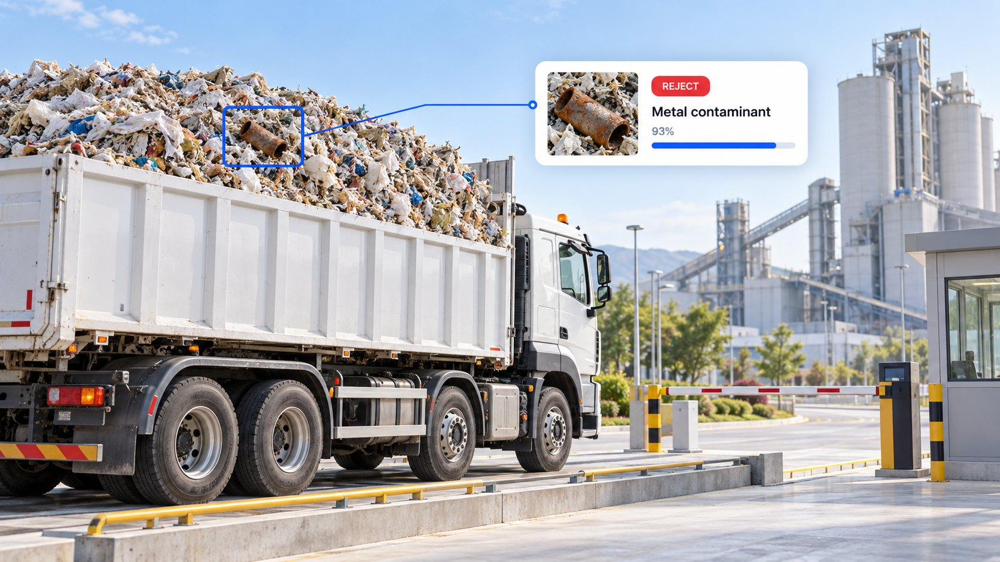

# Lynceus

<p align="center">
  
</p>

**AI gate inspector for alternative-fuel (RDF) facilities — built for the AMD
Developer Hackathon: ACT III (Intelligent Industry track).**

Lynceus inspects a waste truck's load at the weighbridge, before it is tipped
into the plant. The load photo, the waybill, the weighed mass and the gate gas
readings are fused into one verdict — **ACCEPT / ESCALATE / REJECT** — by a
rule-based, regulation-grounded decision engine. The AI models only *observe*
(what is in the photo, what the waybill says); the engine decides, and every
inspection is sealed as a tamper-evident, SHA-256-digested audit record.

> One escaped metal chunk can wreck a shredder and stop a kiln. Run live on
> AMD Token Factory, Lynceus stopped **19 of 20** metal-waste loads and passes
> **35 of 40** clean RDF loads straight through, with a verdict in about
> **20 seconds** ([Results](#results)).

**Contents:** [Intelligent Industry](#built-for-intelligent-industry) ·
[The console](#the-console) ·
[AI on AMD Token Factory](#ai-on-amd-token-factory) ·
[Architecture](#architecture) · [Results](#results) ·
[Quickstart](#quickstart) ·
[Configuration](#environment-variables) · [API](#api) · [Tests](#tests) ·
[Licences](#licences)

## Built for Intelligent Industry

Cement plants replace coal with refuse-derived fuel (RDF), but every truck of
shredded waste can hide metal, stone or tyres. One piece that reaches the
shredder or the kiln destroys the machine and stops the line — up to
**Rp 798 million per incident** (a Rp 350 million industrial shredder plus an
hour of lost clinker at US$28,000/h). Today a gate officer checks loads by eye
and keeps no record. Lynceus moves that check to the weighbridge, *before* the
load is tipped.

| The track asks for | Lynceus delivers |
|---|---|
| **A real manufacturing problem** | Fuel contamination at the receiving gate of a cement / waste-to-energy plant: the cause of shredder damage and unplanned kiln stops. |
| **Detect defects from images** | A vision model on AMD Token Factory reads the load photo, names the contaminants and boxes them; a CPU YOLO26m detector checks the same photo as a second opinion. |
| **Reduce downtime, increase safety** | Metal is stopped at the gate: 19 of 20 metal loads rejected live, and with the detector second opinion no metal load is let through ([Results](#results)). |
| **Explain anomalies** | Every verdict says why: what the camera saw, whether it matches the waybill, which of the six gate checks failed. |
| **Help technicians search manuals** | Pythia answers gate questions only from the plant's SOP and reference documents, with citations. |
| **Recommend actions** | A next-step card after every verdict, each step citing a gate-SOP clause; one-click supplier notice and supervisor escalation. |
| **Use resources efficiently** | Clean RDF passes straight through (35 of 40), so good fuel is not wasted on manual checks; waybill OCR fills the register from a photo. |
| **Results operators understand** | One word per truck — ACCEPT, ESCALATE or REJECT — with the photo, boxes and reasons, sealed in a tamper-evident audit record. |
| **A measurable improvement** | Per 1,000 trucks (base case of the shipped value model): expected escaped hard loads **6 → 1**, trucks checked by hand **1,000 → ~140**, operator time **−69 %**, expected damage **Rp 239 M → Rp 40 M**, net value **≈ Rp 150 M** after the cost of wrongly rejected loads. |
| **AMD technology** | All live AI — load vision, waybill OCR, waybill cross-check, Pythia — runs on AMD Token Factory (AMD GPUs). |

Who uses it: **gate operators** (one photo, one verdict, one sealed record),
**shift supervisors** (review queue, repeat-offender suppliers) and **plant
managers** (an audit-ready trail of every load).

## The console

A Next.js 15 static export served by the backend. Sign-in is required when
`LYNCEUS_ADMIN_USERNAME` and a password are set; otherwise the console is open.

| Page | What the operator does there |
|---|---|
| **Inspection** (`/app`) | Upload the load photo and the waybill photo. The waybill is read by the vision model (OCR) and **auto-fills the register** (plate, supplier, net weight, stream, moisture); auto-filled fields are marked and stay editable, an unreadable field stays empty, and a failed read offers **Retry**. Inspect → verdict with the six gate checks, hazard boxes on the photo, the next-step card and Pythia. On the verdict: **Notify supplier** and **Escalate** (to a supervisor, with an optional note). |
| **Audit trail** (`/inspections`) | Ledger of sealed records with verdict tabs, a filter popover (supplier, period, failed check), search and CSV export. A record opens the full detail: verdict, evidence photo with boxes, the gate checklist, inputs, SOP next steps, the follow-up log, Pythia, and the raw record as a JSON download. |
| **Shift report** (`/shift`) | Trucks inspected and rejected, worst-case exposure, the verdict mix, the open review queue and supplier risk with repeat-offender flags. On first start it is seeded with a scripted 24-truck sample shift, labelled as such. |

**Next-step card.** After every verdict a deterministic rule table lists what to
do at the gate; each step cites a clause of the reference gate SOP.

**Pythia.** A gate assistant that answers only from the plant knowledge base
(`backend/src/lynceus/knowledge/*.md`) and the open record, with citations;
an ungrounded answer is replaced by "cannot answer".

**Follow-up actions.** Notifying the supplier or escalating never touches the
sealed record. Each action is appended to a separate, hash-chained log next to
it (`actions.jsonl`); the chain is re-verified on every read. A supplier notice
is built deterministically from the record (plate, verdict, contaminants seen,
SOP next steps, record id and digest) and is POSTed to
`SUPPLIER_NOTIFY_WEBHOOK` when set, otherwise only logged.

## AI on AMD Token Factory

The live AI runs on **AMD Token Factory** (AMD's free, shared, OpenAI-compatible
model endpoints, running on AMD GPUs), reached with one team API key. No GPU is
needed at the gate: the console calls the Token Factory API, and the detector
second opinion runs on an ordinary CPU.

| Role | Model | Why |
|---|---|---|
| Vision: contaminants, wet/dry, hazard boxes, waybill OCR | `DeepSeek-V4-Flash-Vision-Exp` (fallback `Gemma-4-31B-IT`) | Winner of a 10-model bake-off on truck-bed photos: metal found 3/3, clean load kept clean 3/3, and the fastest of the accurate models. Gemma ties on accuracy and serves as the fallback. |
| Waybill cross-check, Pythia, shift explanations | `DeepSeek-V4-Flash` | Passed the assistant citation contract 3/3 and the waybill JSON contract 3/3 on a deliberately contradictory waybill. |
| Detector second opinion: metal, glass, organic boxes | YOLO26m fine-tuned on RealWaste + TACO, bundled ONNX (`backend/models/`) | Runs on the gate PC's CPU (ONNX Runtime), so the gate keeps a second pair of eyes even when the endpoint is busy. |

Probe and bake-off data: `docs/research/token-factory-probe.md`,
`docs/research/vlm-bakeoff-2026-10-17.json`,
`docs/research/llm-contract-2026-10-17.json`.

## Architecture

```
load photo + waybill + weight + gas   (inputs frozen + SHA-256 digested)
        │
        ▼
VLM  (DeepSeek-V4-Flash-Vision-Exp)  ──► contaminants, wet/dry, confidence, hazard boxes
LLM  (DeepSeek-V4-Flash)             ──► waybill fields, claim-vs-observation cross-check
YOLO26m detector (ONNX, CPU)         ──► metal / glass / organic boxes (can only hold a truck)
gas  (digital twin, or a sensor gateway when LYNCEUS_GAS_SENSOR_URL is set)
        │
        ▼
Fusion + rule-based decision engine  (cited: Eq. HH-1 40 CFR 98, EN 15359-style route scores)
        │
        ▼
Verdict ACCEPT / ESCALATE / REJECT + gates + audit record (atomic, tamper-evident)
        │
        ├──► Next-step card    (deterministic rule table, each step cites a gate-SOP clause)
        ├──► Pythia            (BM25 over the plant knowledge base + the current record)
        ├──► Follow-up log     (append-only, hash-chained: supplier notice, escalation)
        └──► Shift report      (aggregation over stored records; supplier flags)

Waybill OCR (before the inspection): waybill photo ──► VLM ──► register fields
```

Built to fail safe:

- **Detector second opinion.** A metal box the vision model did not confirm
  holds the truck for a human (escalate); so does an unconfirmed glass/organic
  box while `DETECTOR_ESCALATE_LIGHT=1`. The detector never accepts or rejects
  on its own. Its dashed boxes, model, runtime and latency are shown; the audit
  record also stores the weights' SHA-256 and the thresholds used.
- **Votes and fallback.** The vision model votes over `VLM_VOTES` reads
  (default 3, in parallel) and can fall back to other models
  (`VLM_FALLBACK_MODELS`) inside one time budget; a fallback outside
  `VLM_BENCHMARKED_MODELS` can never accept or reject.
- **Strict boxes.** The VLM's hazard boxes are validated; malformed boxes are
  dropped, never repaired.
- **Clear provenance.** Live results are labelled "Live AMD" with model and
  latency. A stub answer after a live failure is labelled as a scripted
  fallback. With `LYNCEUS_ALLOW_STUB_FALLBACK=0` and the vision model down, a
  readable photo gets a detector-only verdict that always holds the truck for a
  human (`detector_only_degraded`); without the detector it returns HTTP 503.
- **Real or simulated gas.** Gate gas readings come from a physics digital
  twin, or from a sensor gateway when `LYNCEUS_GAS_SENSOR_URL` is set; the
  record says which.
- **OCR never guesses.** An unreadable waybill field is returned as `null`; if
  the reader is down, `POST /waybill/extract` returns 503 and the operator types
  the register by hand. Large photos are re-encoded (long side ≤ 2000 px) before
  the call so a slow endpoint still answers in time.

## Results

Measured live on **AMD Token Factory**: 80 labelled public waste photos
(RealWaste — 20 metal, 60 from seven other classes), each sent through the full
`POST /inspect` pipeline.

| Gate outcome | Result |
|---|---|
| Metal loads stopped at the gate | **95 %** — 19 of 20 rejected |
| Clean RDF loads passed straight through | **88 %** — 35 of 40 |
| Metal loads let through, with the detector second opinion | **0 of 20** |
| Time to verdict, end to end | **~20 s** median |

The clean-load figure scores the recorded live model outputs with the current
decision rules, which treat plastic film and textile as the RDF feedstock they
are. The detector figure fuses the same live outputs with the bundled YOLO26m
detector: every metal load is either rejected or held for an operator.

**Picking the vision model.** Ten vision models on Token Factory were run on
the truck-bed photos with the production prompt, three times each.
`DeepSeek-V4-Flash-Vision-Exp` and `Gemma-4-31B-IT` both found the metal 3/3
and kept the clean load clean 3/3; DeepSeek was faster (p50 18–32 s vs
28–35 s) and ships as the primary, with Gemma as the fallback.

**Value per 1,000 trucks.** `GET /shift-report` returns a `value_model`: the
expected cost with and without Lynceus (escaped hard loads, equipment damage,
operator time, wrongly rejected clean loads), with every parameter sourced or
marked as an adjustable assumption and a low/base/high range. Model:
`backend/src/lynceus/impact.py`.

**Reproduce.** Raw rows, summaries and framing are committed in
`backend/benchmark/results/` (the newest summary is served at
`GET /benchmark/latest`); the model bake-off is in
`docs/research/vlm-bakeoff-2026-10-17.json`. From `backend/`:

```bash
PYTHONPATH=src python -m benchmark.run --min-interval 4     # live run (needs the images and a key)
PYTHONPATH=src python -m benchmark.rescore --source benchmark/results/2026-10-13.jsonl   # offline re-score
```

## Business case and operator validation

- Users, buyers, market (Indonesia and Italy), competitors and pricing:
  [`docs/BUSINESS.md`](docs/BUSINESS.md).
- A 15-minute interview kit to check the problem, its cost and willingness to
  pay with an RDF gate operator or co-processing manager:
  [`docs/operator-validation-kit.md`](docs/operator-validation-kit.md).

## Repository layout

```
backend/                FastAPI app: AI pipeline, decision, audit records
  src/lynceus/            service package (api, pipeline, decision, actions, followup,
                          assist, shift, audit, impact, detector, auth)
  src/lynceus/knowledge/  plant knowledge base used by Pythia (markdown, package data)
  src/lynceus_engine/     the vendored decision engine (pure Python, MIT)
  models/                 bundled YOLO26m ONNX detector + NOTICE
  benchmark/              validation benchmark: manifest, runner, committed results
  scripts/                seed_demo.py (sample-shift seeding), probe_token_factory.py
  tests/                  backend tests + opt-in live smoke module
web/                    operator console — Next.js 15 (App Router) static export
ml/                     detector training, evaluation and ONNX export
deploy/                 container entrypoint, env template, deployment guide
docs/                   business case, research notes, hackathon checklist, assets
Dockerfile              single-container image (API + built UI)
```

## Quickstart

### Local development

Requirements: Python 3.12+, Node.js 20+.

```bash
# 1. Build the web UI (static export -> web/out/)
cd web && npm ci && npm run build && cd ..

# 2. Run the backend (serves the API and the built UI)
cd backend
pip install -e ".[dev]"
cp ../.env.example .env        # then paste the Token Factory key; see below
python -m lynceus.main         # http://localhost:8020
```

Open <http://localhost:8020>. Inspections and waybill OCR need the Token Factory
key. Without it the live call fails: by default
(`LYNCEUS_ALLOW_STUB_FALLBACK=1`) an inspection answers with an offline
scripted stub labelled `stub_fallback_live_error` and the UI says so; with
`LYNCEUS_ALLOW_STUB_FALLBACK=0` it returns HTTP 503. Waybill OCR never uses a
stub. The 24-truck sample shift is seeded offline and needs no key.

### Docker

```bash
docker build -t lynceus .
cp deploy/lynceus.env.example deploy/lynceus.env   # git-ignored; paste the key, set a password
docker run -d --name lynceus -p 8020:8020 \
  --env-file deploy/lynceus.env \
  -v lynceus-runs:/data/runs \
  lynceus
```

Use the Docker template, not `.env.example`: the template carries the console
login (set `LYNCEUS_ADMIN_PASSWORD` to turn sign-in on) and
`LYNCEUS_ALLOW_STUB_FALLBACK=0` (fail closed), and it never
sets `LYNCEUS_STORAGE_DIR`, `LYNCEUS_WEB_DIR` or `LYNCEUS_BENCHMARK_DIR`, so the
container's `/data/runs` volume path stays in force (the entrypoint exits with
an error if the storage dir is not writable).

On first start (empty storage) the container seeds the 24-truck sample shift,
then serves on `${PORT:-8020}`. Records persist in the `lynceus-runs` volume.
The API key is read from `--env-file` at run time and is never copied into the
image. Full server guide (HTTPS, updates, backups, judging-day checklist):
[`deploy/README.md`](deploy/README.md).

### Environment variables

Token Factory settings (local: `backend/.env`; Docker: `deploy/lynceus.env`;
never commit the key; get the team key at `notebooks.amd.com/tokenfactory`):

```bash
VLLM_VLM_URL=https://developer.amd.com.cn/radeon/api/v1
VLLM_LLM_URL=https://developer.amd.com.cn/radeon/api/v1
VLLM_API_KEY=rc-your-team-key
VLM_MODEL=DeepSeek-V4-Flash-Vision-Exp
VLM_FALLBACK_MODELS=Gemma-4-31B-IT
LLM_MODEL=DeepSeek-V4-Flash
LYNCEUS_ALLOW_STUB_FALLBACK=0
```

An inspection submitted without a `demo_case` carries `provenance: "live"`. The
key is rate-limited and shared across the team; the client honours
`Retry-After` on HTTP 429.

Full reference (defaults are the code defaults, used when a variable is unset):

| Variable | Default | Meaning |
|---|---|---|
| `VLLM_VLM_URL` | `http://localhost:8000/v1` | OpenAI-compatible endpoint for the vision model (also used for waybill OCR) |
| `VLLM_LLM_URL` | `http://localhost:8001/v1` | OpenAI-compatible endpoint for the text model |
| `VLLM_API_KEY` | *(empty)* | Bearer key sent to the endpoints (the Token Factory team key); no auth header when empty |
| `VLM_MODEL` | `Qwen/Qwen2.5-VL-7B-Instruct` | Vision-language model id |
| `LLM_MODEL` | `Qwen/Qwen2.5-7B-Instruct` | Text model id |
| `VLM_FALLBACK_MODELS` | *(empty)* | Comma-separated vision fallback chain, tried in order inside one time budget |
| `VLM_BENCHMARKED_MODELS` | `MiniCPM-V-4.7-35B-A3B` | Fallback models allowed to accept or reject (those with an 80-image benchmark run behind them); the primary VLM is exempt, any other fallback can only escalate |
| `VLM_VOTES` | `3` | Vision reads per photo, merged by majority vote (1..3, run in parallel) |
| `ASSIST_URL` / `ASSIST_MODEL` | `VLLM_LLM_URL` / `LLM_MODEL` | Endpoint and model for Pythia |
| `EXPLAIN_URL` / `EXPLAIN_MODEL` | `ASSIST_URL` / `ASSIST_MODEL` | Endpoint and model for shift-report supplier explanations |
| `LOCALISATION_MODE` | `box` | Hazard localisation: `box` or `zone` |
| `LYNCEUS_ALLOW_STUB_FALLBACK` | `1` | `0` / `false` / `no`: a live-AI failure returns HTTP 503 instead of the offline stub (use for hosted demos) |
| `LYNCEUS_ADMIN_USERNAME` | *(empty)* | Console login user; login is on only when this and a password are set |
| `LYNCEUS_ADMIN_PASSWORD` / `LYNCEUS_ADMIN_PASSWORD_SHA256` | *(empty)* | Login password, or its hex SHA-256 (takes precedence, so the raw password need not be stored) |
| `SUPPLIER_NOTIFY_WEBHOOK` | *(empty)* | https URL that receives a POSTed supplier notice (5 s timeout); empty, non-https or a failed POST = the notice is only logged in the follow-up log |
| `LYNCEUS_GAS_SENSOR_URL` | *(empty)* | HTTP/JSON gate gas-sensor gateway; empty = physics digital twin |
| `DETECTOR_MODEL_PATH` | bundled `backend/models/lynceus-yolo26m-realwaste-taco.onnx` | Detector weights; empty = detector off |
| `DETECTOR_HARD_CONF` / `DETECTOR_LIGHT_CONF` | `0.35` / `0.05` | Detector thresholds for metal / glass+organic, picked on a val split (`backend/models/README.md`) |
| `DETECTOR_ESCALATE_LIGHT` | `1` | An unconfirmed glass/organic box holds the truck too |
| `DETECTOR_THREADS` / `DETECTOR_PROVIDERS` | `2` / `CPUExecutionProvider` | ONNX Runtime threads and execution providers |
| `LYNCEUS_STORAGE_DIR` | `./runs` (`/data/runs` in the image) | Where audit records and follow-up logs live |
| `LYNCEUS_WEB_DIR` | `<repo>/web/out` (`/app/web/out` in the image) | Static web export to serve |
| `LYNCEUS_BENCHMARK_DIR` | `<repo>/backend/benchmark` (`/app/backend/benchmark` in the image) | Benchmark manifest and results for `/benchmark/latest` |
| `PORT` | `8020` | Listening port of `python -m lynceus.main` |

## API

All routes except `/health`, the login routes and the static pages require a
session when login is on (401 JSON otherwise).

| Route | Purpose |
|---|---|
| `GET /health` | Liveness, version, engine availability |
| `POST /auth/login` · `POST /auth/logout` · `GET /auth/session` | Console session |
| `POST /inspect` | Full gate inspection: VLM + LLM + detector + engine → sealed verdict |
| `POST /waybill/extract` | Read a waybill photo into register fields (503 `ocr_unavailable` when the reader is down) |
| `POST /assist` | Pythia: cited answers over the plant documents and a record |
| `GET /inspections` | Ledger rows (verdict, reason, digest, follow-up counts) |
| `GET /inspections/{id}` | One audit record, digest re-verified on read |
| `GET /inspections/{id}/evidence/{slot}` | The archived load or waybill photo |
| `GET` · `POST /inspections/{id}/actions` | Follow-up log: list (with `chain_ok`) or append `notify_supplier` / `escalate` |
| `GET /shift-report` | Shift aggregation, supplier risk and explanations, `value_model` |
| `GET /benchmark/latest` · `GET /benchmark/replay` · `GET /benchmark/manifest.csv` | Committed validation results |
| `POST /assess` | One batch assessment through the decision engine alone |

`POST /inspect` also accepts a scripted `demo_case` for the seeder and tests;
the console does not offer it.

## Tests

```bash
cd backend
PYTHONPATH=src python -m pytest tests/ -q   # 603 passed, 1 skipped
```

The skipped test is the live smoke module; enable it with `LYNCEUS_LIVE_TESTS=1`
(needs a live endpoint and key). The web console type-checks and builds with
`npx tsc --noEmit` and `npm run build` in `web/`.

## Licences

- Lynceus code: MIT (see `LICENSE`).
- **RealWaste images** (the benchmark images in `backend/benchmark/images/`)
  are from the RealWaste dataset (Single, Iranmanesh, Raad, University of
  Wollongong; UCI ML Repository id 908) and remain under their own licence. The
  licence statements disagree: the UCI page says **CC BY 4.0**, the README
  inside the dataset zip says **CC BY-NC-SA 4.0**. Until the authors clarify,
  treat the more restrictive terms as binding (attribution, non-commercial,
  share-alike). Details: `backend/benchmark/images/ATTRIBUTION.md`. The
  benchmark images are excluded from the Docker image.
- **Third-party model weights.** The bundled CPU detector
  (`backend/models/lynceus-yolo26m-realwaste-taco.onnx`) is **not** covered by
  the MIT licence. The weights derive from Ultralytics YOLO26 (**AGPL-3.0**) and
  were fine-tuned on RealWaste (**CC BY-NC-SA 4.0** treated as binding, as
  above) and TACO (annotations **CC BY 4.0**). Their training and export source
  is in `ml/` (our offer of the corresponding source). Commercial use requires
  retraining on your own data and an Ultralytics Enterprise licence, or a
  permissively licensed detector (`DETECTOR_MODEL_PATH` points at it; empty
  turns the detector off). Details: `backend/models/NOTICE`.
