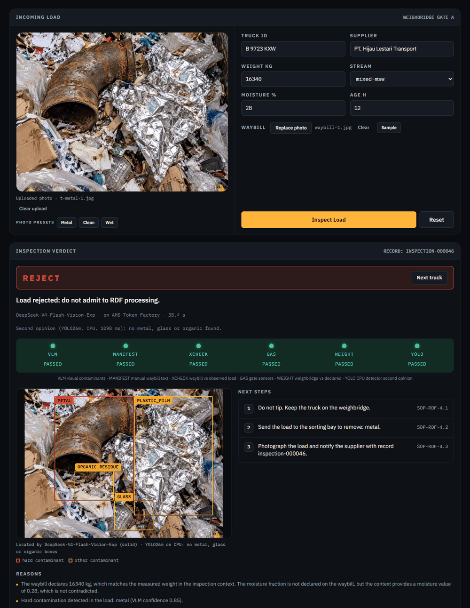

# Lynceus

**AI gate inspector for alternative-fuel (RDF) facilities — built for the AMD Developer Hackathon: ACT III (Intelligent Industry track).**

| | |
|---|---|
| **Live demo** | <https://lynceus.web.id> — sign in with `admin` / `admin123` (also shown on the sign-in page) |
| **AMD technology** | Every vision, waybill and assistant call runs on **AMD Token Factory** (AMD GPUs): `DeepSeek-V4-Flash-Vision-Exp` (vision), `Gemma-4-31B-IT` (vision fallback; until it has its own benchmark run it can only hold a truck for a person), `DeepSeek-V4-Flash` (waybill + assistant) |
| **Source** | <https://github.com/rafilajhh/lynceus> |
| **Team** | Rafi Cahya Mahardika, Muhammad Muqorrobin Al Anshori |



*A live run on the AI-generated metal demo photo (17 Oct 2026, first call on a cold
endpoint: 38 s). The vision model found and boxed the steel pipe; the CPU detector,
trained on RealWaste close-ups and TACO litter photos, found nothing on this
truck-bed framing — which is
why it can only add a hold, never clear a load.*

Lynceus inspects a waste truck's load at the weighbridge before it is tipped
into the plant. A photo of the load, the waybill text, the weighed mass and gate
gas readings are fused into a verdict — **ACCEPT / ESCALATE / REJECT** — by a
rule-based, regulation-grounded decision engine. The AI models only *observe*
(what is in the photo, whether the waybill matches it); the verdict is decided by
the engine, and every inspection is stored as a tamper-evident, SHA-256-audited
record.

After the verdict the operator gets a **next-step card** (what to do at the gate,
each step citing a clause of the reference gate SOP), can ask **Pythia** (a
gate assistant that answers only from plant documents, with citations), and the
**shift report** shows what the gate caught, what it saved and which suppliers
repeat.

> One escaped metal chunk can wreck a shredder and stop a kiln. On 80 public waste
> photos run live on AMD Token Factory (all 80 answered), the shipped gate — the
> vision model plus the CPU detector's second opinion — **let none of the 20
> metal-waste photos through** (8 rejected, 12 held for an operator), held all 20
> glass/organic loads for review, and passed 37 of 40 paper, cardboard, plastic and
> textile photos straight through ([Validation](#validation): single-item public
> photos, not plant data; the detector fusion is an offline replay of the live
> answers, and the rules were tuned on earlier runs of these photos).

## What the demo actually runs

The live AI runs on **AMD Token Factory** (AMD's free shared, OpenAI-compatible
endpoint catalogue, running on AMD GPUs), reached with one team API key:

| Role | Model | Why (measured in `docs/research/token-factory-probe.md` + the 2026-10-17 truck-photo bake-off) |
|---|---|---|
| Vision: contaminants, wet/dry, hazard boxes | `DeepSeek-V4-Flash-Vision-Exp` | detects the metal on the truck-bed photo 3/3 AND stays clean on the clean load 3/3 (JSON 8/9, hazard boxes, p50 18-32 s). `Gemma-4-31B-IT` matches detection and cleanliness (metal 3/3, clean 3/3, JSON 8/9) but is slower (p50 28-35 s) and has no full benchmark run — it ships as the fallback vision model. `MiniCPM-V-4.7-35B-A3B` — the earlier pick from the RealWaste probe — is not reliable on the truck photos: one read times out on the metal photo, its JSON parses on only 1 of 3 clean-load reads and 1 of 3 ambiguous reads, and its latency reaches 84 s. `DeepSeek-V4.1-Flash` times out on images |
| Waybill cross-check and Pythia | `DeepSeek-V4-Flash` | passed the assistant citation contract 3/3 and the waybill JSON contract 3/3 on the contradictory waybill (`Gemma-4-31B-IT` failed the citation contract 0/3; `Qwen3.8-Flash-Next` breaks JSON 2/3; `GLM-5.3-Flash` times out / 429s) |
| Detector second opinion: metal, glass, organic boxes | YOLO26m fine-tuned on RealWaste + TACO, bundled ONNX (`backend/models/`) | runs on the gate PC's CPU (ONNX Runtime), so it keeps working when the shared endpoint is down. Out of domain (TACO litter scenes) it finds 14/29 metal photos where the first model found 2/29 (`backend/models/README.md`) |

It is not a self-hosted GPU stack: the demo calls the Token Factory API and
needs no GPU of its own.

## Architecture

```
photo + waybill text + weight + gas   (inputs frozen + SHA-256 digested)
        │
        ▼
VLM  (DeepSeek-V4-Flash-Vision-Exp, Token Factory)  ──► contaminants, wet/dry, confidence, hazard boxes
LLM  (DeepSeek-V4-Flash)         ──► waybill fields, claim-vs-observation cross-check
YOLO26m detector (ONNX, CPU)     ──► metal / glass / organic boxes (can only hold a truck)
gas  (digital twin, or a sensor gateway when LYNCEUS_GAS_SENSOR_URL is set)
        │
        ▼
Fusion + rule-based decision engine  (cited: Eq. HH-1 40 CFR 98, EN 15359-style route scores)
        │
        ▼
Verdict ACCEPT / ESCALATE / REJECT + gates + audit record (atomic, tamper-evident)
        │
        ├──► Next-step card   (deterministic rule table, each step cites a gate-SOP clause)
        ├──► Pythia           (BM25 over the plant knowledge base + the current record;
        │                      ungrounded answers are replaced by "cannot answer")
        └──► Shift report     (aggregation over stored records; supplier flags with a
                               model or rule explanation)
```

### Features

- Photo + waybill + weight + gas fusion with a cited, deterministic verdict.
- Hazard localisation: the VLM's boxes are strictly validated (malformed boxes are dropped, never repaired) and drawn on the photo.
- Next-step card with SOP-cited actions after every verdict.
- Pythia assistant grounded in `backend/src/lynceus/knowledge/*.md` and the open record, with citations.
- Shift report with a scripted sample shift (24 trucks, seeded offline, labelled "Sample shift — scripted data") and repeat-supplier flags.
- Ledger of stored inspections (`/inspections`).
- `/validation` page: the benchmark below, with its framing.
- Detector second opinion: a bundled YOLO26m detector reads the same photo. A metal box the vision model did not confirm holds the truck for a human (escalate); so does an unconfirmed glass/organic box while `DETECTOR_ESCALATE_LIGHT=1`. It never accepts or rejects on its own. Its dashed boxes, model, runtime (`onnxruntime-cpu`) and latency are shown; the audit record also stores the weights' SHA-256 and the thresholds used.
- The vision model votes over `VLM_VOTES` reads (default 3, run in parallel) and can fall back to other benchmarked vision models (`VLM_FALLBACK_MODELS`) inside one time budget; a fallback outside `VLM_BENCHMARKED_MODELS` can never accept or reject.
- Honest provenance: live results are labelled "Live AMD" (the verdict also shows model and latency on one quiet line); a stub answer after a live failure is labelled as a scripted fallback. With `LYNCEUS_ALLOW_STUB_FALLBACK=0` and the vision model down, a readable photo gets a detector-only verdict that always holds the truck for a human (`detector_only_degraded`); without the detector it returns HTTP 503 instead of an offline stub.

### Limits stated up front

- `POST /inspect` accepts an optional waybill photo (`waybill_image_base64`), but no model reads it: it is digested and archived in the audit record as evidence. The verdict uses the load photo plus the waybill *text* sent as `manifest_text`; no OCR is performed. The web console has no waybill-text field: it derives that text from the registered stream and weighed mass (`Dry <stream>, no metal, declared <kg> kg`), so in the console demo the waybill/weight cross-check agrees by construction. A client that sends the real waybill text (an API caller, or a typed field in a later version) gets the full cross-check.
- The live verdict typically takes 10–30 s (benchmark p50 12 s, p95 27 s end to end); the shared endpoint occasionally needs a retry, which the client does inside one time budget.
- Gas readings come from a physics digital twin unless `LYNCEUS_GAS_SENSOR_URL` points at a sensor gateway; the record says which (`digital_twin` or `sentinel_gate_sensor`).

## Validation

**Component validation on public RealWaste images — not field data from a plant.**

80 RealWaste images (Metal 20, plus 60 from seven other classes at fixed quotas;
see `backend/benchmark/images/ATTRIBUTION.md`), each posted live to
`POST /inspect` on Token Factory with a fixed neutral waybill. The expected
verdict per image is in `backend/benchmark/manifest.csv`.

### The shipped gate (2026-10-17 run: DeepSeek-V4-Flash-Vision-Exp + YOLO26m)

All 80 images answered live (`2026-10-17.deepseek-vision-exp.jsonl`; 10 of 90
attempts failed on the shared endpoint — 8 read timeouts, 2 unreachable — and
were retried by the resumable runner; every attempt is kept in the file). The vision model's answers were then fused with the CPU
detector's second opinion through the production rules
(`2026-10-17.deepseek-vision-exp.hybrid-rescore.summary.json`, detector at its
shipped thresholds, light escalation on — the production default):

| Metric | Vision model alone (live) | **Shipped gate: vision + CPU detector** |
|---|---|---|
| Metal photos let through (ACCEPT) | 12 / 20 | **0 / 20** |
| Metal photos rejected outright | 8 / 20 (precision 1.00) | 8 / 20 (precision 1.00) |
| Metal photos held for an operator | 0 / 20 | 12 / 20 |
| Glass / organic loads held for review (ESCALATE recall) | 7 / 20 | **20 / 20** |
| Clean RDF loads passed (ACCEPT) | 40 / 40 | 37 / 40 |
| Trucks sent to an operator | 7 / 80 | 35 / 80 |
| Verdict = expected | 55 / 80 | 65 / 80 |
| End-to-end latency (live) | p50 12.2 s, p95 27.1 s | the detector runs in parallel (~1 s on CPU) |

Read it the way the gate is built: the vision model is precise (it never
rejected a clean load) but, on these close-up single-item photos, misses 12 of
20 metal items; the detector catches every one of those misses and holds the
truck for a human, so **no metal photo is accepted**. The price is review
load: 35 of 80 trucks go to an operator, where today the gate officer checks
every truck by eye. The fusion is an offline replay of the recorded live
answers (no new model calls), the detector thresholds were picked on a separate
val split, and the decision rules were tuned on the earlier 2026-10-13 run of
these same photos, so this is not a held-out result. `/validation` on the live
site shows both columns.

### Earlier run: MiniCPM-V-4.7-35B-A3B (2026-10-13, retired as the primary vision model)

| Metric | Live run (rules of 2026-10-13) | Current rules (replay) |
|---|---|---|
| Metal gate (REJECT) recall | 0.95 (19/20) | 0.95 (19/20) |
| Metal gate (REJECT) precision | 0.86 (19/22) | 0.90 (19/21) |
| Clean RDF loads passed (ACCEPT) | 0.30 (12/40) | 0.88 (35/40) |
| Trucks sent to an operator (ESCALATE) | 0.55 (44/80) | 0.26 (21/80) |
| Escalate-expected loads escalated (ESCALATE recall) | 0.90 (18/20) | 0.85 (17/20) |
| n | 80, one run | same 80 recorded outputs |
| Completed-request latency (end to end) | p50 19.5 s, p95 34.4 s | no new model calls |
| Requests that needed a retry | 3 of 83 attempts | — |

The **replay** feeds the recorded live model outputs of the same run through the
current decision rules, without new model calls, so it scores every rule change made
after the run, not one. Two changes landed since: (1) hard contaminants are read only
from the model's structured fields, not its prose — the live run rejected one plastic
load (`plastic_277.jpg`) because the word "concrete" appeared in the description, and
this change alone moves metal precision from 0.86 to 0.90; (2) plastic film and
textile, which the live run escalated as "light contaminants", are the calorific
fraction RDF is made from and are now treated as feedstock — this moves clean
loads passed from 0.30 to 0.88. The cost is one escalate-expected load (a glass image,
`glass_121.jpg`, whose only flag was plastic film) now passing: ESCALATE recall falls
from 0.90 to 0.85. Both changes were motivated by this same data, so the replay is
not a held-out measurement.

Raw rows: `backend/benchmark/results/2026-10-13.jsonl` and
`2026-10-17.deepseek-vision-exp.jsonl`; each has a `.summary.json`, a replay
(`.rescore.{jsonl,summary.json}`) and a detector-fused replay
(`2026-10-17.hybrid-rescore.realwaste-taco-m.summary.json` for MiniCPM,
`2026-10-17.deepseek-vision-exp.hybrid-rescore.summary.json` for DeepSeek).
Re-run the live benchmark from `backend/` with
`PYTHONPATH=src python -m benchmark.run --min-interval 4 --out benchmark/results/<name>.jsonl`
(needs the images, which are not shipped in the Docker image, and a live key;
it resumes and retries error rows); re-score offline with
`PYTHONPATH=src python -m benchmark.rescore --source benchmark/results/<name>.jsonl`
and add `--hybrid --run-detector --out benchmark/results/<name>.hybrid-rescore.summary.json`
for the fused gate. The newest live run, its replay and its fused replay are
served at `/benchmark/latest` and shown on `/validation`.

This measures the vision gate on one dataset in one run. It says nothing about
performance on a particular plant's trucks, lighting or waste mix.

**Vision-model bake-off and the 2026-10-17 run (DeepSeek-V4-Flash-Vision-Exp).**
The shipped vision model was re-picked on 2026-10-17 with a 10-model bake-off
on the AI-generated truck-bed demo photos (production prompt, 3 runs per photo):
`DeepSeek-V4-Flash-Vision-Exp` and `Gemma-4-31B-IT` both detected the metal 3/3
and stayed clean 3/3; DeepSeek wins the latency tie-break (p50 18-32 s vs
28-35 s) and ships as the primary, Gemma as the fallback. `MiniCPM-V-4.7-35B-A3B`
— the 2026-10-13 pick — is not reliable here: one read times out on the metal
photo, its JSON parses on only 1 of 3 clean-load reads and 1 of 3 ambiguous
reads, and its latency reaches 84 s. The remaining candidates failed in
different ways: timeouts (`DeepSeek-V4.1-Flash`, `GLM-5.3-Flash`), unparseable
or empty JSON (`Qwen3.8-Flash-Next`, `MiMo-V2.6-Flash`), HTTP errors
(`MiniCPM5-2B`), not vision-capable (`DeepSeek-V4-Flash`), or hallucinated hard
contaminants on the clean load (`MiniCPM-V-4.7-1B`). Raw rows:
`docs/research/vlm-bakeoff-2026-10-17.json`.

The same 80-image RealWaste benchmark was then run live with the new model (the
shipped-gate table above): on these close-up single-item photos the new model
alone is clearly weaker than MiniCPM — metal recall 0.40 (8/20) against 0.95 —
while it passes every clean load. The truck-bed framing it was picked on is a
different domain from RealWaste close-ups, and this run says so plainly. What
matters for the gate is the hybrid, where both models end at 0 metal accepted;
the MiniCPM hybrid replay reaches a higher verdict accuracy (0.90 against 0.81)
with fewer operator holds, but MiniCPM cannot run the truck demo usefully (one
metal-read timeout, JSON parses on only 1 of 3 clean and ambiguous reads, 84 s
latency). The truck photo is the demo; RealWaste close-ups are the benchmark.
Both results are kept and stated.

Bake-off limits, stated: the probe runs the exact production prompt but at
temperature 0.0 (production votes at 0.1) with 512-token reads, and it recorded
box counts only — the counts themselves varied across runs (e.g. 6/4/4 on the
metal photo for the winner), so spatial box consistency was not validated. The
decisive evidence for the pick is detection correctness, cleanliness, latency,
and the live `/inspect` run plus the committed benchmark artifacts — not box
stability.

**Value per 1,000 trucks.** The `/shift` page turns these rates into an expected
value with and without Lynceus (escaped hard loads, damage, operator time, cost
of wrongly rejected clean loads), with every parameter either sourced or marked
as an adjustable assumption and a low/base/high range — the low case is negative
and is shown as such. Model: `value_model` in `backend/src/lynceus/impact.py`.

## Business case

Users, buyers, market (Indonesia and Italy), competitors and the pricing
proposal: [`docs/BUSINESS.md`](docs/BUSINESS.md).

## Operator validation

A 15-minute interview kit to check the problem, its cost and willingness to pay
with an RDF gate operator or co-processing manager:
[`docs/operator-validation-kit.md`](docs/operator-validation-kit.md).

## What was built when

The decision engine (`backend/src/lynceus_engine/`: gas assessment, mass
balance, route suitability scoring) is the team's own earlier MIT-licensed
engine, vendored into this repository on 13 October 2026, the second day of the
hackathon (commit `80b86a3`), and renamed. Everything else was built during the
hackathon (12–18 October 2026): the AMD Token Factory AI layer (vision model,
voting and fallback chain, waybill cross-check, Pythia), the multi-modal fusion
and verdict rules, the CPU detector (training, evaluation, ONNX export in
`ml/`), the tamper-evident audit records, the next-step card, the shift report
and value model, the validation benchmark and the web console.

## Repository layout

```
backend/            FastAPI app: engine adapter, AI pipeline, audit records
  src/lynceus/        the service package (api, pipeline, decision, actions, assist, shift, audit, impact)
  src/lynceus/knowledge/  plant knowledge base used by Pythia (markdown, package data)
  src/lynceus_engine/ the decision engine (pure Python, MIT; see "What was built when")
  tests/              backend tests + opt-in live smoke module (LYNCEUS_LIVE_TESTS=1)
  scripts/            seed_demo.py (demo / sample-shift seeding), probe_token_factory.py
  benchmark/          validation benchmark: manifest, runner, committed results, images
web/                Operator console — Next.js 15 (App Router) static export
deploy/             container entrypoint and the deployment guide
docs/               business case, submission text, operator kit, research notes, screenshots
ml/                 detector training, evaluation and export (source of the bundled weights)
Dockerfile          single-container image (API + built UI)
```

## Quickstart

### Local development

Requirements: Python 3.12+, Node.js 20+.

```bash
# 1. Build the web UI (static export -> web/out/)
cd web && npm ci && npm run build && cd ..

# 2. Run the backend (serves the API and the built UI)
cd backend
pip install -e ".[dev]"
cp ../.env.example .env        # then edit; see the env table below
python -m lynceus.main         # http://localhost:8020
```

If `npm run build` fails with `Cannot find module '../lightningcss.<platform>.node'`,
npm skipped an optional native package during `npm ci` (seen once on Windows; the
lockfile does list it). Delete `web/node_modules` and run `npm ci` again.

Open <http://localhost:8020>. The workspace takes an uploaded photo plus the register
(truck, stream, weight; the waybill photo is optional evidence); inspections need the Token Factory settings below. Without a key the live call
fails: by default (`LYNCEUS_ALLOW_STUB_FALLBACK=1`) the backend answers with an
offline scripted stub labelled `stub_fallback_live_error` and the UI says so; with
`LYNCEUS_ALLOW_STUB_FALLBACK=0` it returns HTTP 503. The 24-truck sample shift is
seeded offline and needs no key. (`POST /inspect` still accepts a scripted
`demo_case` for the seeder and tests; the UI no longer offers it.)

### Docker

```bash
docker build -t lynceus .
cp deploy/lynceus.env.example deploy/lynceus.env   # git-ignored; paste the Token Factory key
docker run -d --name lynceus -p 8020:8020 \
  --env-file deploy/lynceus.env \
  -v lynceus-runs:/data/runs \
  lynceus
```

Use the Docker template, not `.env.example` or `backend/.env`: those are for local
development, with localhost endpoint URLs and models, whereas the template carries the
Token Factory endpoints and models and `LYNCEUS_ALLOW_STUB_FALLBACK=0`. It never sets
`LYNCEUS_STORAGE_DIR`, `LYNCEUS_WEB_DIR` or `LYNCEUS_BENCHMARK_DIR`, so the container's
`/data/runs` volume path stays in force (the entrypoint exits with an error if the
storage dir is not writable).

On first start (empty storage) the container seeds the 24-truck sample shift,
then serves on `${PORT:-8020}`. Records persist in the `lynceus-runs` volume. The
API key is read from `--env-file` at run time and is never copied into the image.
Full server guide (HTTPS, updates, backups, judging-day checklist):
[`deploy/README.md`](deploy/README.md).

### Environment variables

| Variable | Default | Meaning |
|---|---|---|
| `VLLM_VLM_URL` | `http://localhost:8000/v1` | OpenAI-compatible endpoint for the vision model |
| `VLLM_LLM_URL` | `http://localhost:8001/v1` | OpenAI-compatible endpoint for the text model |
| `VLM_MODEL` | `Qwen/Qwen2.5-VL-7B-Instruct` | Vision-language model id |
| `LLM_MODEL` | `Qwen/Qwen2.5-7B-Instruct` | Text model id |
| `ASSIST_URL` | value of `VLLM_LLM_URL` | Endpoint for Pythia |
| `ASSIST_MODEL` | value of `LLM_MODEL` | Model id for Pythia |
| `EXPLAIN_URL` | value of `ASSIST_URL` | Endpoint for shift-report explanations (separate role) |
| `EXPLAIN_MODEL` | value of `ASSIST_MODEL` | Model id for shift-report explanations |
| `LOCALISATION_MODE` | `box` | Hazard localisation: `box` or `zone` |
| `VLLM_API_KEY` | *(empty)* | Bearer key sent to the endpoints (the Token Factory team key); no auth header when empty |
| `LYNCEUS_ALLOW_STUB_FALLBACK` | `1` | `0` / `false` / `no`: a live-AI failure returns HTTP 503 instead of the offline stub (use for hosted demos) |
| `LYNCEUS_GAS_SENSOR_URL` | *(empty)* | HTTP/JSON gate gas-sensor gateway; empty = physics digital twin |
| `LYNCEUS_STORAGE_DIR` | `./runs` (`/data/runs` in the image) | Where inspection audit records live |
| `LYNCEUS_WEB_DIR` | `<repo>/web/out` (`/app/web/out` in the image) | Static web export to serve |
| `LYNCEUS_BENCHMARK_DIR` | `<repo>/backend/benchmark` (`/app/backend/benchmark` in the image) | Benchmark manifest and results for `/benchmark/latest` |
| `PORT` | `8020` | Listening port of `python -m lynceus.main` |
| `VLM_VOTES` | `3` | Vision reads per photo, merged by majority vote (1..3, run in parallel) |
| `VLM_FALLBACK_MODELS` / `VLM_BENCHMARKED_MODELS` | *(empty)* / `MiniCPM-V-4.7-35B-A3B` | Vision fallback chain; only benchmarked **fallback** models (i.e. with an 80-image benchmark run behind them) may accept or reject — the primary VLM is exempt. The Docker template (`deploy/lynceus.env.example`) sets `VLM_FALLBACK_MODELS=Gemma-4-31B-IT` (commented out in `.env.example`); Gemma has no 80-image run yet, so when it answers it can only hold a truck for a human, never accept or reject it |
| `DETECTOR_MODEL_PATH` | the bundled `backend/models/lynceus-yolo26m-realwaste-taco.onnx` | Detector weights; empty = detector off |
| `DETECTOR_HARD_CONF` / `DETECTOR_LIGHT_CONF` | `0.35` / `0.05` | Detector thresholds for metal / glass+organic, picked on a val split (`backend/models/README.md`) |
| `DETECTOR_ESCALATE_LIGHT` | `1` | An unconfirmed glass/organic box holds the truck too |

Token Factory settings (local dev: put them in `backend/.env`; Docker: `deploy/lynceus.env`; never commit the key; get the
team key at `notebooks.amd.com/tokenfactory`):

```bash
VLLM_VLM_URL=https://developer.amd.com.cn/radeon/api/v1
VLLM_LLM_URL=https://developer.amd.com.cn/radeon/api/v1
VLM_MODEL=DeepSeek-V4-Flash-Vision-Exp
LLM_MODEL=DeepSeek-V4-Flash
ASSIST_URL=https://developer.amd.com.cn/radeon/api/v1
ASSIST_MODEL=DeepSeek-V4-Flash
LOCALISATION_MODE=box
VLLM_API_KEY=rc-your-team-key
LYNCEUS_ALLOW_STUB_FALLBACK=0
```

Submit an inspection **without** a `demo_case` and the response carries
`provenance: "live"`. The Token Factory key is rate-limited per key and shared
across the team; the client honours `Retry-After` on HTTP 429.

## Tests

```bash
cd backend
PYTHONPATH=src python -m pytest tests/ -q   # all pass; 1 skipped (live smoke)
```

The skipped test is the live smoke module; enable it with `LYNCEUS_LIVE_TESTS=1`
(needs a live endpoint and key).

## Licences

- Lynceus code: MIT (see `LICENSE`).
- **Demo images** in `web/public/demo/` (the truck-bed photos and the sample
  waybill) were generated with an image model for this demo; they are fictitious
  and show no real truck, company or person (`web/public/demo/README.md`).
- **RealWaste images** (the benchmark images in `backend/benchmark/images/`)
  are from the RealWaste dataset (Single,
  Iranmanesh, Raad, University of Wollongong; UCI ML Repository id 908) and
  remain under their own licence. The licence statements disagree: the UCI page
  says **CC BY 4.0**, the README inside the dataset zip says **CC BY-NC-SA 4.0**.
  Until the authors clarify, treat the more restrictive terms as binding
  (attribution, non-commercial, share-alike). Details:
  `backend/benchmark/images/ATTRIBUTION.md`. The benchmark images are excluded
  from the Docker image.
- **Third-party model weights.** The bundled CPU detector
  (`backend/models/lynceus-yolo26m-realwaste-taco.onnx`) is **not** covered by the
  MIT licence. The weights derive from Ultralytics YOLO26 (**AGPL-3.0**) and
  were fine-tuned on RealWaste (**CC BY-NC-SA 4.0** treated as binding, as
  above) and TACO (annotations **CC BY 4.0**). Their training and export source is in `ml/` (our offer of the
  corresponding source). Commercial use requires retraining on your own data
  and an Ultralytics Enterprise licence, or a permissively licensed detector
  (`DETECTOR_MODEL_PATH` points at it; empty turns the detector off). Details:
  `backend/models/NOTICE`.
